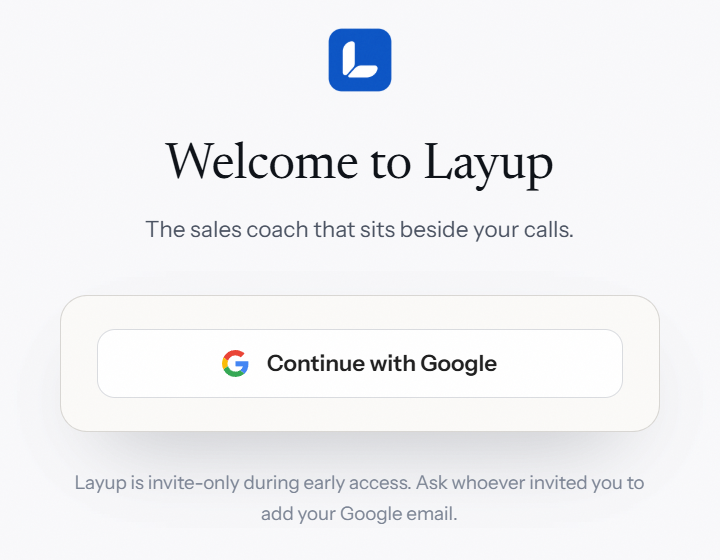
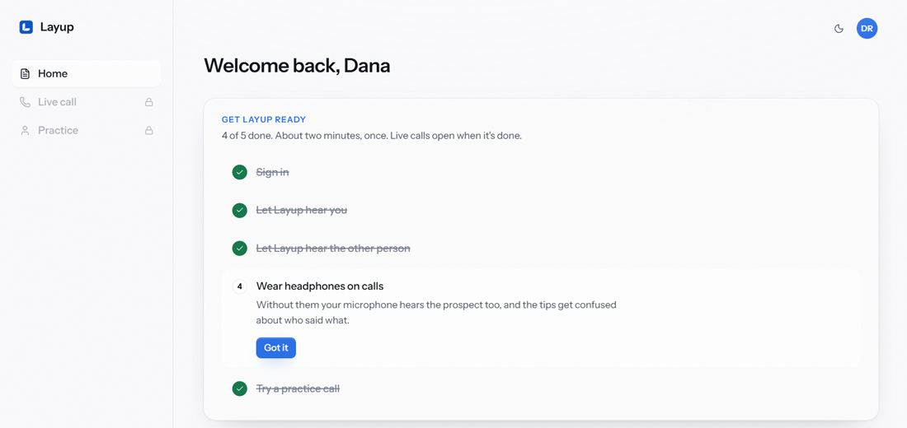
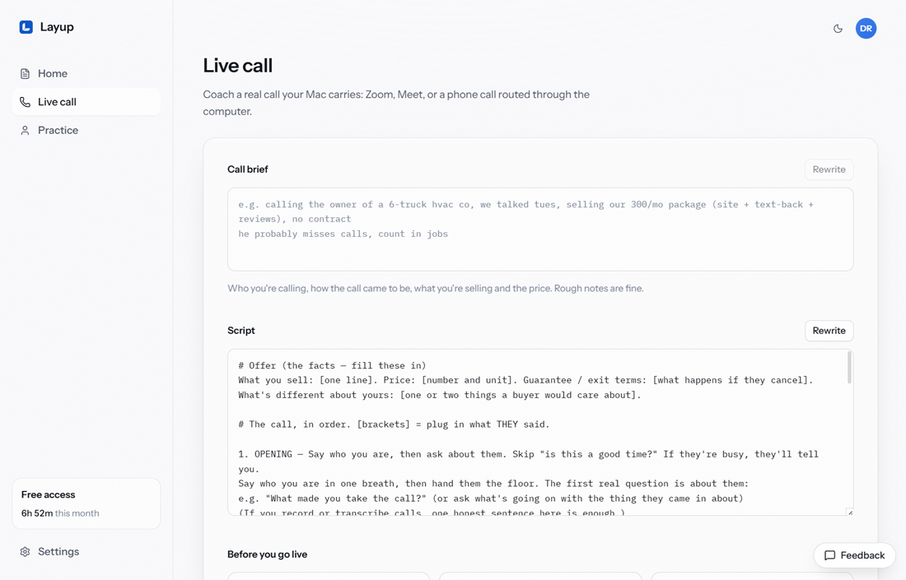
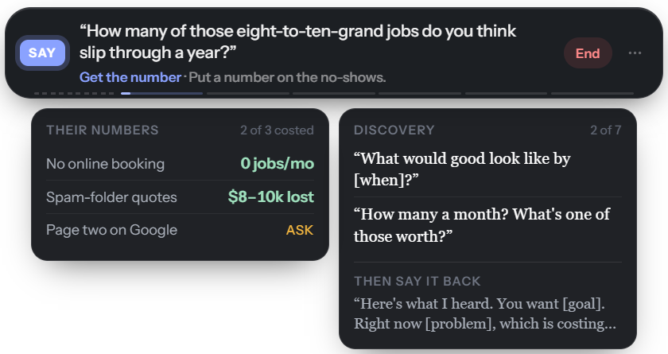
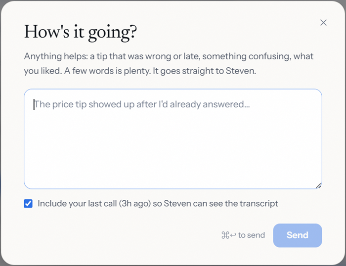

# Layup

Layup is a Mac app that coaches you during sales calls. While you talk, it listens to both sides and shows one short tip at a time in a small bar at the top of your screen. When the call ends you get a report card and a follow-up email ready to send.

This is an early, invite-only build. You can sign in only after Steven has added your Google email.

**Setting up takes about 15 minutes, once.** Go through this page top to bottom the first time.

1. [What you need](#what-you-need)
2. [Download](#download)
3. [Install](#install-about-2-minutes)
4. [Sign in](#sign-in)
5. [Get Layup ready](#get-layup-ready-the-setup-list)
6. [Write your script](#write-your-script-10-minutes-and-it-matters-most)
7. [Try a practice call](#try-a-practice-call)
8. [Coach a real call](#coach-a-real-call)
9. [After the call](#after-the-call-your-report-card)
10. [Send feedback](#send-feedback)
11. [Updating to a new version](#updating-to-a-new-version)
12. [If something goes wrong](#if-something-goes-wrong)
13. [Your privacy](#your-privacy)

## What you need

- **A Mac running macOS 13 or newer.** Layup does not run on Windows, an iPhone or an iPad.
- **Headphones.** Earbuds, AirPods or a headset are all fine. Without them, your microphone picks up the other person and the tips get mixed up.
- **The Google email Steven invited.** If you're not sure which one, ask him.
- **Your Mac password.** macOS asks for it a couple of times during setup.

## Download

1. Go to **[the latest release](https://github.com/stevenheffner/layup-releases/releases/latest)**.
2. Scroll down to **Assets** and click one file to download it:
   - **`Layup-…-arm64.dmg`** if your Mac has an Apple chip (M1 or newer). This is most Macs bought since 2021.
   - **`Layup-….dmg`** (no "arm64" in the name) if your Mac has an Intel chip.

Not sure which chip you have? Click the Apple menu  in the top-left corner of your screen, then **About This Mac**. If it says **Chip: Apple M1** (or M2, M3, M4…), download the arm64 file. If it says **Processor: … Intel**, download the other one.

## Install (about 2 minutes)

1. Open your **Downloads** folder and double-click the `.dmg` file. A window opens showing the Layup icon and an Applications folder.
2. Drag the Layup icon onto the Applications folder. Wait for the copy to finish.
3. Open **Finder**, click **Applications** in the left column, and double-click **Layup**.
4. The first time, macOS stops it with a message: **"Layup" Not Opened** ("Apple could not verify…"). This is normal for a test app. Click **Done**. Do **not** click Move to Trash.
5. Click the Apple menu , then **System Settings**.
6. In the left column, click **Privacy & Security**. Scroll all the way down the right side until you see a line about Layup being blocked. Click **Open Anyway** next to it.
7. Double-click **Layup** in Applications again. macOS asks one more time: click **Open Anyway**, and type your Mac password if it asks.

You only do steps 4 to 7 once. After that, Layup opens like any other app.

## Sign in

1. Layup opens on **Welcome to Layup**. Click **Continue with Google**.
2. Your web browser opens a Google page. Click the Google account Steven invited. If Google asks you to sign in, do that.
3. The browser shows **You're signed in. Go back to Layup. You can close this tab.** Close the tab.
4. Layup comes back to the front with your name at the top.

You never type a password or a key into Layup itself.

If the browser says **That Google account isn't on Layup's invite list yet**, text Steven the exact email you picked. Once he's added it, go back to Layup, click **Cancel**, and click **Continue with Google** again.

## Get Layup ready (the setup list)

After you sign in, Layup's Home page shows a list called **Get Layup ready**. It has five steps. Only the next step to do is open, and each step gets a green tick when it's done. **Live calls stay locked until all five are ticked.**

**Step 1: Sign in.** Already done.

**Step 2: Let Layup hear you.**
1. Click **Allow microphone**.
2. macOS asks whether Layup can use the microphone. Click **Allow**.

**Step 3: Let Layup hear the other person.** This one has the most clicks, so go slowly.
1. Click **Allow call audio**.
2. macOS says Layup wants to **record your screen and audio**. That's macOS's wording, and it's the only way macOS lets an app hear a call. Layup only uses the sound, turns it into text, and never looks at your screen.
3. Click **Open System Settings** in that message.
4. System Settings opens on **Screen & System Audio Recording**. Find **Layup** in the list and switch it on. Type your Mac password if asked.
5. macOS offers **Quit & Reopen**. Click it. Layup closes, opens again, and lands back on the list with step 3 ticked.

If you missed the macOS message, click **Open System Settings** under step 3 in Layup, switch Layup on there, then click **Reopen Layup**.

**Step 4: Wear headphones on calls.** Put your headphones on and click **Got it**.

**Step 5: Try a practice call.** Click **Start a practice call**. The next two sections explain how. The list is finished once your first practice call ends.

When all five are ticked, Layup shows **You're set**, and the **Live call** page unlocks.

## Write your script (10 minutes, and it matters most)

Layup coaches you against your own script. The tips are only as good as what you give it.

> **Important: keep your script somewhere else too.** Layup does not save your script yet. Each time Layup quits or your Mac restarts, the Script box goes back to the template. Write your script in **Notes** (or a Google Doc), then copy it and paste it into Layup's **Script** box before each session.

Each call page (**Live call** and **Practice**) has two boxes:

- **Call brief:** a few rough lines about *this* call. Who you're calling, how the call came about, what you're selling, and the price. Layup remembers your brief.
- **Script:** how you run your calls. It starts with a template. Replace it with your own.

Your script should cover these six things, in plain words:

1. **What you sell and what it costs.** One or two sentences. Give the real price and the real terms (contract or not, trial or not).
2. **The goal of this call.** For example: "book a 15-minute meeting at a set day and time" or "close the sale on this call." Add the fallback if there is one, such as "or a callback on a named day."
3. **Who you are, in one line.** For example: "I'm Dana. I build websites for local contractors." Layup shows you this when the other person asks "who is this?"
4. **Your main lines, in the order you say them.** Put each line you actually say in "quotes." Layup shows quoted lines as your next line, so only quote words you would say out loud. Do not put the other person's questions in quotes.
5. **Your answers to the objections you already hear.** Write each one as: "what they say" → "what you say back." Cover at least price, "I don't need it," "send me something," and any question you get on every call (for a website: "do I keep the site if I cancel?"). Give the honest answer. Layup shows your answer word for word.
6. **The facts people ask about.** Put a short list at the top: what it works with, how setup goes, how long it takes, what happens if they cancel. In test calls, the most common reason a call stalled was a product question the script had no answer for. If you don't know an answer, write "I don't know yet, I'll confirm in writing," so Layup shows you that and not a guess.

Two things to avoid:

1. **Don't write anything that isn't true.** If your opener is a stretch, the other person catches it, and you spend the rest of the call recovering.
2. **Don't leave out the price or the catch.** People ask, and a straight answer keeps them on the phone.

Messy notes are fine. Click **Rewrite** above either box and Layup tidies them into the shape the coach reads best. It keeps your facts and invents nothing. If you don't like the result, click **Undo**.

If you want the template back, click **Reset to template** above the Script box.

## Try a practice call

A practice call is a pretend call with an AI prospect called Sam, so you can see how the tips work before a real call. It takes about two minutes.

1. Put your headphones on.
2. Click **Practice** in the left column.
3. Under **Difficulty**, pick **Easy** for your first try. **Standard** is a realistic prospect, and **Hard** pushes back a lot.
4. Fill in the **Call brief** and paste your **Script**. Or click a **Scenario** to fill both with an example.
5. Click **Start practice call**. You hear a short ring, then Sam answers in your headphones. Your microphone turns on by itself.
6. Talk to Sam as if it were a real call. Tips appear in the bar at the top of your screen (see the next section).
7. To finish, click **End** on the bar at the top of your screen. Sam may also hang up on you, which ends the call too. Your report card opens.

## Coach a real call

1. **Put your headphones on.**
2. **Join the call the way you normally do**: Zoom, Google Meet, or a phone app on your Mac. Layup doesn't dial. It only listens to whatever your Mac is playing.
3. Open Layup and click **Live call** in the left column.
4. Check the **Call brief** for this prospect, and paste your **Script** if the box shows the template.
5. Scroll down to **Before you go live** and click **Go live**.
6. **Tell the other person the call is transcribed.** One sentence is enough, for example: "Heads up, I use a note-taker that transcribes my calls." Several states, including California, require it, and the template script's opening has a line for it.

Once you've done this once, you can also start from the top of your screen: the small round Layup button sits at the top centre whenever the Layup window is closed. Move your mouse over it and click **Go live**.

**During the call**, the bar at the top of your screen shows one tip at a time:

- A **SAY** tag means the tip is a line you can say word for word.
- The small grey line under the tip says where you are in the call and what to aim for next.
- **Listening** means there's no tip right now. Just keep talking.
- Click **⋯** (or right-click the bar) to show or hide **their numbers** (the problems and costs the prospect has mentioned) and **the script**.

**To end the call**, click **End** on the bar. You can also click **⋯** and then **End call**.

## After the call: your report card

When the call ends, the Layup window opens with your **Call review**. Grading usually takes under a minute.

- **Score** out of 100, with one line on how the call went.
- **Qualified prospect?** Four checks: is it a fit, do you know what the problem costs them, do you know who decides, and is there a dated next step. Missing any one of them caps the score.
- **What worked**, **What to improve** and the **Key moment** of the call.
- **Follow-up to send within the hour**: a draft email in the prospect's own words. Click **Copy email**, then paste it into your email app and check it before you send.

Every call, with its report card, is listed on **Home**. Click a call to open it again.

## Send feedback

This is the most useful thing you can do for Steven. A few words is enough.

1. Click **Feedback** in the bottom-right corner of the Layup window. During a call, click **⋯** on the bar at the top of your screen and choose **Send feedback…**.
2. Type what happened: a tip that was wrong or late, something confusing, or something you liked.
3. Leave **Include your last call** ticked if it's about a call, so Steven can read the transcript.
4. Click **Send**.

Your note tells Steven which screen you were on and which call it's about, so you don't need to explain that. If you don't see a Feedback button, text or email Steven instead. A screenshot helps a lot: press **Shift-Command-4** and drag around the part of the screen you want.

## Updating to a new version

Layup doesn't update itself yet. When Steven tells you there's a new version:

1. Click Layup's icon in the menu bar at the top right of your screen and choose **Quit Layup**.
2. Download and install the new version the same way as above (see [Download](#download) and [Install](#install-about-2-minutes)). When the Mac asks, click **Replace**.
3. Open Layup. It may show the **Get Layup ready** list again and ask for the microphone and the call audio again. Allow both. When macOS offers **Quit & Reopen**, click it.
4. Paste your script back in.

## If something goes wrong

**It says the Google account isn't on the invite list, or my sign-in expired.**
Text Steven the Google email you used. He has to add it. Then click **Continue with Google** again.

**It says to choose a plan.**
Don't pay for anything. Text Steven, and he'll switch your account on.

**Live call or Go live is greyed out, with a lock.**
Finish the **Get Layup ready** list on Home first. Every step needs a green tick.

**No tips appear on a real call, or the other person's side is missing.**
1. Click **Settings** at the bottom of the left column, then **System**.
2. Under **macOS permissions**, both **Microphone** and **Screen & System Audio Recording** should say **Allowed**.
3. If one doesn't, open System Settings → **Privacy & Security** → that same item (**Microphone** or **Screen & System Audio Recording**), and switch Layup on. Then quit Layup and open it again.

**The tips are confused about who said what, or repeat my own words.**
Put headphones on.

**The bar at the top of my screen disappeared.**
It hides while the Layup window is open. Close the Layup window and it comes back. If it still doesn't, click Layup's icon in the menu bar at the top right of your screen and tick **Show status pill**.

**The Layup window disappeared.**
Click Layup's icon in the menu bar at the top right of your screen and choose **Open Layup**. Or click the round Layup button at the top centre of your screen and click **Open Layup**.

**Anything else.**
Quit Layup (menu bar icon → **Quit Layup**), open it again, and try once more. If it still fails, send feedback or text Steven: say what you were doing, what you expected, and what happened.

## Your privacy

- **Audio never leaves your Mac.** Layup turns the call into text as it goes, and no recording is kept.
- The text of each call, the tips and the report card are saved on your Mac. A text-only copy also goes to your Layup account, so your report cards work and Steven can look into a call you sent feedback about.
- To stop keeping transcripts in your account, go to **Settings** → **Data and Privacy** and switch off **Keep call transcripts in my account**. **Delete all stored calls** on the same page removes the ones already there.
